<div align="center">

# Lumière Château: Runes of the Sword

*Lumière Şatosu: Kılıcın Rünleri*

A third-person exploration and adventure game inspired by the châteaux of Île-de-France, running entirely in the browser.


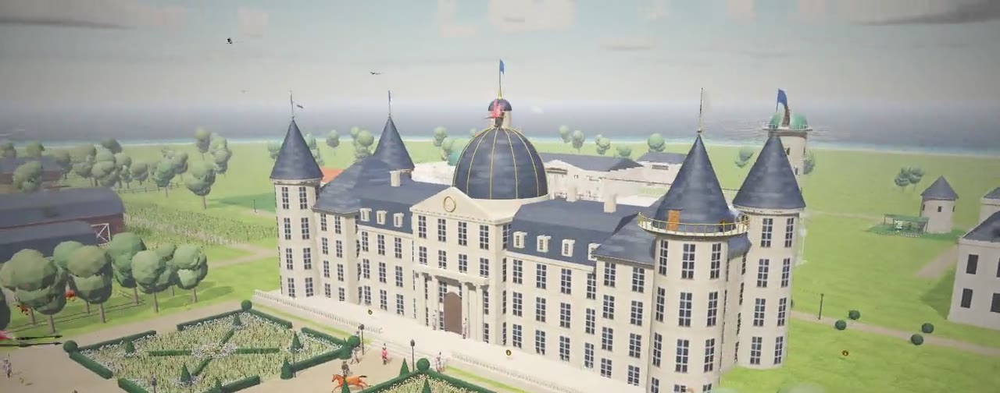

</div>

The sword in the temple has slept for a hundred years. Find the five runes hidden around the château, shape the blade at the forge and wake it up. Along the way, ride your horse Étoile, fly the dragon Pyra across the sea to the Chinese imperial island of Yùlóng, and sail to islands built by contributors.

Built with three.js r147 and Vite. Every sound effect and every piece of music is synthesized in code with the Web Audio API.

## Videos

### Trailer (61 s)

https://github.com/user-attachments/assets/b813c7f7-79e2-4376-a117-89be9dda47f2

### Every area (1 min 55 s)

A tour of every region of Lumière and Yùlóng Island, plus the building interiors.

[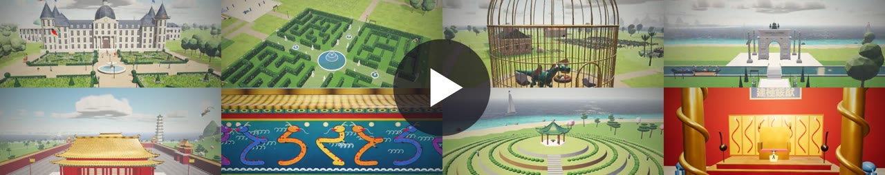](docs/tum-alanlar.mp4)

[docs/tum-alanlar.mp4](docs/tum-alanlar.mp4) · 960×540 · 11.7 MB. The trailer file is also in the repo: [docs/tanitim.mp4](docs/tanitim.mp4) (1280×720).

## Contents

- [Getting started](#getting-started)
- [Controls](#controls)
- [Quests](#quests)
- [Inside the château](#inside-the-château)
- [The world](#the-world)
- [Flying with Pyra the dragon](#flying-with-pyra-the-dragon)
- [Palace gardens and buildings](#palace-gardens-and-buildings)
- [Royal buildings](#royal-buildings)
- [Building interiors](#building-interiors)
- [Yùlóng Island](#yùlóng-island)
- [Voyages between islands: contributor islands](#voyages-between-islands-contributor-islands)
- [Atmosphere and lighting](#atmosphere-and-lighting)
- [Project structure](#project-structure)
- [Assets and licenses](#assets-and-licenses)

## Getting started

Requires Node.js 18+ and a browser with WebGL2 (Chrome, Firefox, Safari).

```bash
npm install
npm run dev
```

The browser opens `http://localhost:5173` automatically. For a production build run `npm run build` (output goes to `dist/`), and `npm run preview` to try it.

## Controls

| Key | Action |
|---|---|
| W A S D / arrow keys | Walk |
| Shift | Run · gallop when mounted |
| Space | Jump |
| E | Talk, inspect, mount/dismount, use doors |
| H | Whistle: your horse Étoile comes to you |
| V | First-person / third-person view while riding |
| Drag the mouse · scroll wheel | Rotate · zoom the camera |
| J or Tab | Quest journal |
| M | Map (you can also click the minimap in the bottom right) |
| Esc or P | Menu (sound, camera sensitivity, graphics quality, photo mode) |
| Phone | Left thumb walks, right thumb turns the camera, buttons in the bottom right |

## Quests

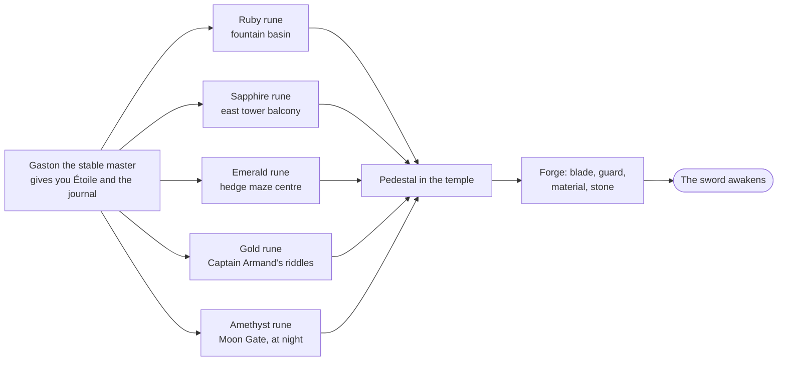

1. **Gaston the stable master** (in front of the western stable): tells the legend, gives you the horse Étoile and opens the quest journal.
2. **Ruby rune:** at the bottom of the fountain. The water is murky in the rain, so look once the weather clears.
3. **Sapphire rune:** on the balcony of the east tower. The door is at the eastern end of the terrace.
4. **Emerald rune:** at the very centre of the eastern hedge maze.
5. **Gold rune:** answer Captain Armand's two riddles on the château steps.
6. **Amethyst rune:** the Moon Gate behind the temple opens only at night. You can move time forward with the sundial in the garden.
7. **Finale:** touch the pedestal in the temple with all five runes, shape the sword at the forge (blade, guard, material, stone) and wake it.
8. **Side quest, Pyra's egg:** talk to Princess Aurélie in the Vineyard of Eden, pick up the purple egg next to the waterfall in Butterfly Valley and bring it to the west gate of the dragon cage.

Étoile waits beside the château terrace from the very start and shows up as a small marker on the compass. Press **H** to whistle and she comes to you. Once you mount, the camera switches to the rider's eyes.

There are also **30 gold medallions** scattered across the garden, the maze, the tower, the greenhouses, the winter garden, the stud farm and inside the château. Your best time and medallion count are saved.

## Inside the château

Press **E** at the main door on the terrace to go in. You climb between floors on foot, by the stairs:

- **Ground floor:** a double-height entrance hall with a great chandelier and Bernard the steward. To the west, the ballroom/dining hall (long table, fireplace); to the east, the music room (with a playable harpsichord).
- **First floor:** the grand staircase leads to the hall's north balcony. To the west, the Hall of Mirrors; to the east, the countess's bedchamber (canopy bed, portrait of the countess).
- **Second floor:** a second staircase east of the balcony leads up to the library (bookshelves, a globe).
- **Third floor:** the spiral staircase in the middle of the library leads up to the observatory in the dome. The whole estate is visible through the telescope.

5 medallions are hidden indoors. Press **E** at the hall door to leave.

## The world

| | |
|:---:|:---:|
| 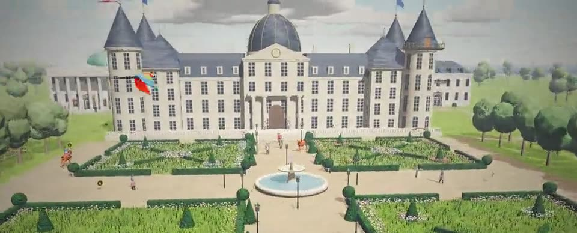<br/>**Baroque garden** | 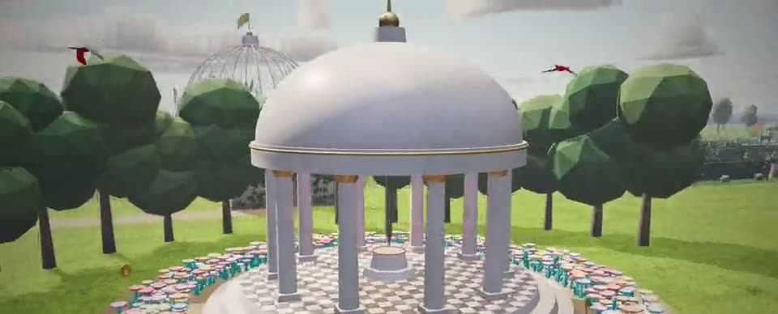<br/>**Temple of the Sword** |
| 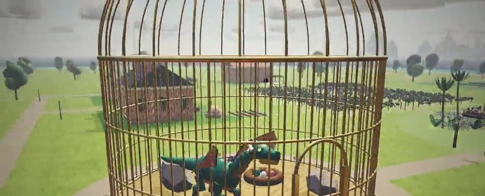<br/>**Dragon cage** | 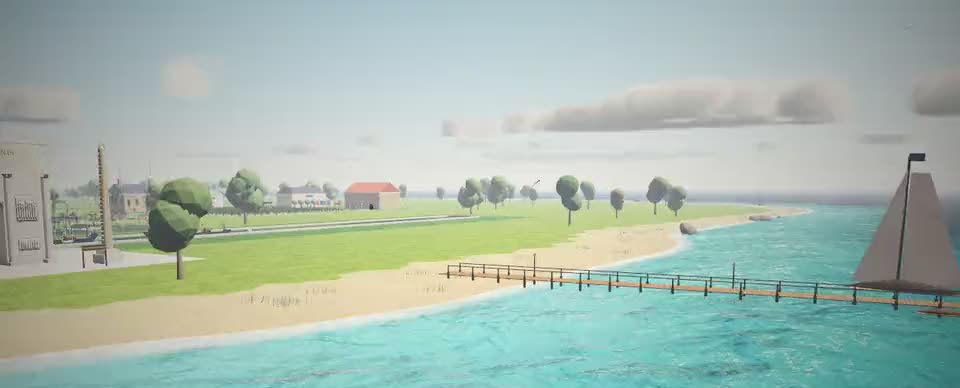<br/>**South beach and pier** |

- **Château and baroque garden:** four flower parterres, a fountain, cone-shaped topiaries, lantern-lit paths, patrolling guards and a mounted patrol.
- **Haras de Lumière (west):** a large wooden stable with a weathervane, a hay shed, five horses in the pasture, a rider training in a white-fenced arena, jumps, a dovecote, water troughs and wildflower meadows.
- **Greenhouses (on both sides of the garden):** on the left the orangery (orange and lemon trees), on the right the tropical greenhouse (palms, ferns, a water lily pond).
- **Winter garden (in front of the main axis, beyond the Moon Gate):** a glass-and-iron domed rotunda with two wings, palms, a pool and potted citrus. Its lanterns light up at night.
- **Dragon cage (east, south of the maze):** a giant domed birdcage with golden bars on a marble plinth. Inside are Pyra, an emerald-scaled, amber-winged dragon, and her nest of colourful eggs. Pyra breathes, follows the player with her head, swishes her tail, and now and then roars and breathes fire.
- **Butterfly Valley:** a flower-arched entrance, a rock pool with a waterfall, water lilies, a winding stream crossed by a wooden arched bridge, palms, giant leaves, beds of colourful flowers swaying in the wind and hundreds of butterflies (they hide at night and in the rain).
- **Vineyard of Eden:** rows of vines, purple and green grape clusters, a marble pergola roofed with vines in the middle, a fountain and rose bushes. Princess Aurélie strolls around the pergola.
- **Wind:** grass, flowers, meadows and trees bend in world space along the wind direction. Gusts roll across the meadow in waves. Flags turn into the wind and ripple, petals drift. The wind follows the weather and is strongest in the rain.
- **Weather and time of day:** sunny, cloudy, rainy, sunset and night cycle on their own, each with its own HDRI lighting. In the rain the horse slows down and the fountain turns murky. At night the guards carry lanterns, the windows light up and the Moon Gate opens.

## Flying with Pyra the dragon

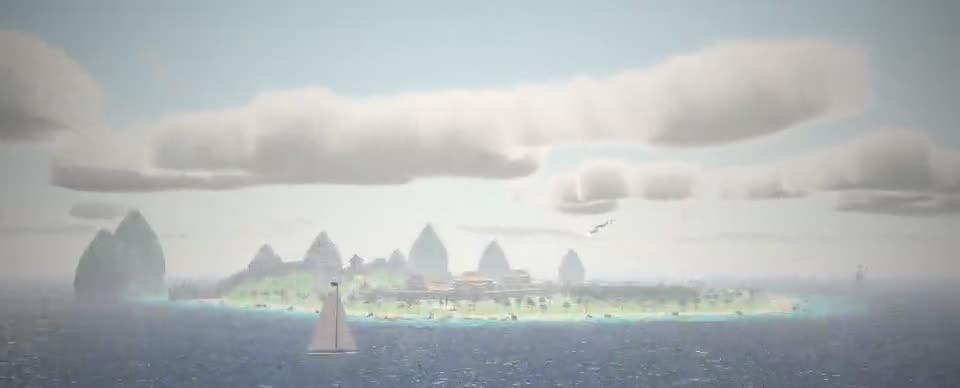

Press **E** next to the west gate of the dragon cage to mount Pyra. She leaves the cage and you settle into the saddle on her back.

| Key | In flight |
|---|---|
| Space | Take off / climb |
| Shift | Dive (you speed up while diving) |
| W / S | Speed up / slow down, hover |
| A / D · drag the mouse | Turn (the dragon banks into the turn); the mouse also steers up and down |
| F | Breathe fire |
| C or V | Camera: rider's eye (over the right shoulder, neck and head ahead) / chase |
| T | Speed up time (next weather and time of day) |
| O | Save a photo |
| E | Land: Pyra touches down, you dismount, and she returns to her cage |

The screen shows altitude, speed and height above ground ("24 m · 1.0 m/s · 20 m above ground") and the place you're over ("Location: Maiden's Tower", for example). When you pass over a place, its name appears in large capitals. Flying low, you won't crash into buildings, and every place you fly over counts as discovered.

## Palace gardens and buildings

| | |
|:---:|:---:|
| 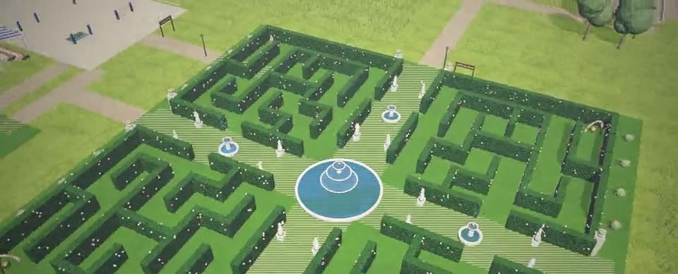<br/>**Rose maze (Jardin des Roses)** | 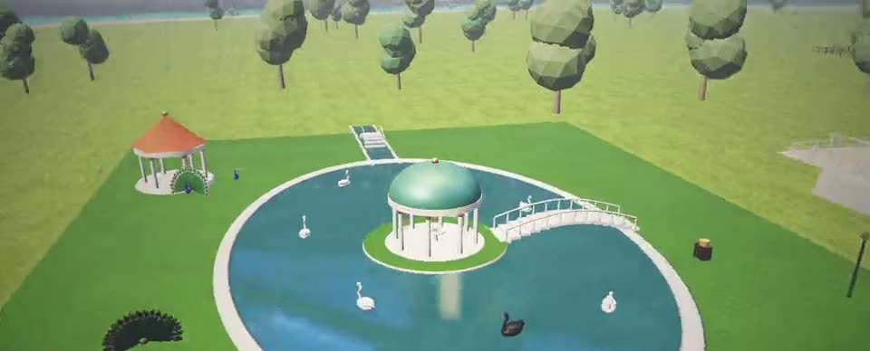<br/>**Swan and peacock pond** |

The estate gained 15 new places. The first time you enter each one a "Discovered" notice appears. The two nearest undiscovered places are shown with gold markers on the compass, and progress is tracked in the quest journal (Explore the palace gardens, x/15).

**Behind the château (north):**
- **Ballroom and orangery:** a great hall with a glass vault, two rows of columns with gilded capitals and three crystal chandeliers. Potted orange and lemon trees stand between the columns on a chequered marble floor. You can walk right in. Press **E** at the orchestra stand: a waltz plays and four couples dance.
- **Palace opera and art gallery (west):** a six-column portico, a pediment, a copper dome and statues on the roof. Maestro Valentin has an aria performed or gives you a tour of the gallery.
- **Library and archive (east):** a mansard roof and a tower clock that runs on real time. Anselme the archivist tells you about the manuscripts and the history of the château, and gives a hint from old chronicles for any rune you haven't found yet.
- **Observatory:** a 22 m stone tower with a slowly turning copper dome and a brass telescope poking out of its slit, an octagonal map room and a turning armillary sphere outside. Talk to Hélène the astronomer and look at the sky through the telescope (stars are visible at night).

**Southwest gardens:**
- **Rose maze (Jardin des Roses):** a symmetric hedge maze laid out as a French garden, its four quarters mirrored. Rose-covered hedges, a great marble basin with a three-tier fountain in the middle, four small fountains along the avenues, a gallery of 16 statues (each pedestal can be read) and rose arbours at the corners of the quarters.
- **Swan and peacock pond:** an oval pond with a copper-domed tea pavilion on its island, a marble arched bridge to the island, a second bridge over the stream to the west and two tea pavilions on the shore. Seven swans swim there (one of them black). Feed them with **E** at the feeding stand and they gather at the shore. Peacocks wander the bank and now and then fan their tails.
- **Riding arena and jumping course:** a sand track, white fencing, vertical, oxer and water jumps and a grandstand with a striped awning. A rider goes round the course and clears the jumps.
- **Chess pavilion:** an ivory and ebony set in a domed pavilion and a giant chessboard on the lawn. Solve Duchess Mathilde's mate-in-one puzzle.

**Northwest and northeast:**
- **Falconry (Fauconnerie):** a half-timbered mews, hooded falcons on their perches, peregrines circling overhead and a fluttering hunting banner. Gaspard the falconer flies "Mistral" from his glove; the bird makes a lap and returns.
- **Marble bathhouse and spa:** a bathhouse with one large and four small domes, an open-air hot pool with a mosaic floor, a colonnade and rising steam.
- **Archery and knife-throwing range:** a shooting field with four targets, a shooting pavilion with an awning and a knife board. Press **E** to pick up the bow and shoot in first person: aim with the mouse, hold the left button to draw and release to loose (a round of 5 arrows, best score is saved). Or throw knives.

**East (crafts and production):**
- **Palace kitchen and gourmet bakery:** a brick kitchen with smoking chimneys, a stone bread oven outside, a bread counter, crates of grapes and oranges and vegetable beds. Chef Antoine serves the dish of the day.
- **Perfume and essence laboratory:** a copper still on a glass veranda, colourful essence bottles and beds of lavender and roses. Choose the top, heart and base notes with Mlle Isabeau and make your own perfume.
- **Silk and fabric workshop:** mulberry trees, bolts of coloured silk billowing in the wind and a loom. Madame Colette sews you a new cape; the colour you pick is applied to your character's cape and saved.
- **Wine cellar (Chai & Caveau):** a stone building with an arched cellar entrance, oak barrels and a vine-covered tasting terrace. Bastien the sommelier pours you one of three vintages.

Static pieces are merged into single meshes by material and region at load time, so the new areas add very few draw calls.

## Royal buildings

| | |
|:---:|:---:|
| 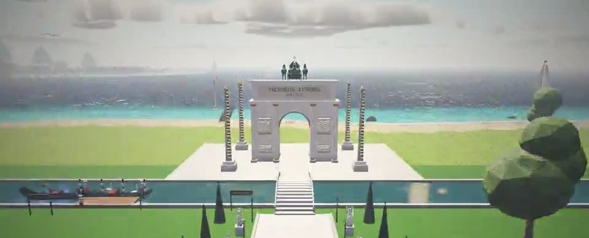<br/>**Triumphal arch over the canal** | 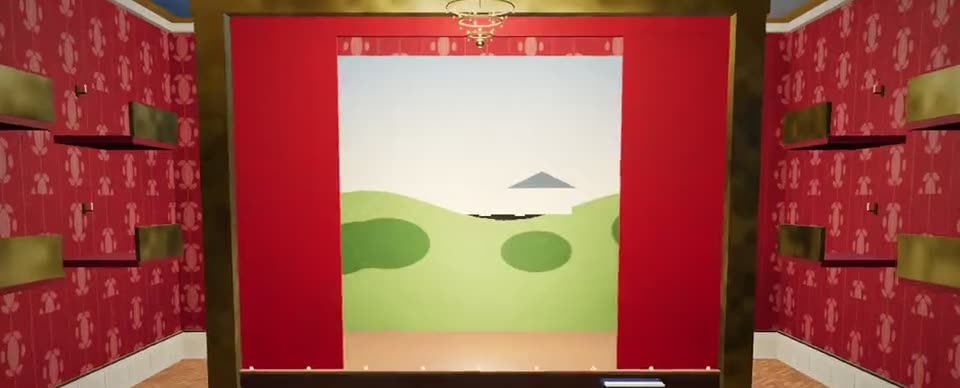<br/>**Palace opera stage** |

12 more places were added to the palace gardens list (27 in total). All of them are tracked on the compass and in the quest journal.

**South entrance:**
- **Swan Stream and gondola pier:** a 300 m marble-edged canal running along the south of the estate. Gondolas rowed by gondoliers in striped shirts and straw hats carry noble couples and turn around at the ends of the canal. Swans glide by. Talk to Luigi the gondolier or press **E** at the pier to board for a cinematic ride (press **E** to get off).
- **Avenue of Heroes:** a marble promenade from the winter garden down to the canal, lined with 14 statues (Augustus, Athena, Heracles, Nike, Charlemagne, Leonidas, Orpheus…), cypress trees and lanterns, with Ionic-columned Greco-Roman temples on both sides. Each statue's pedestal can be read.
- **Triumphal arch and obelisks:** a 16 m triumphal arch past the arched bridge over the canal. Relief panels, a golden arch, the inscription "VICTORIIS · LVMINIS · MDCCXXIV" and a green-patinated four-horse chariot on top. Gold-tipped obelisks covered in hieroglyphs rise on all four sides.
- **Glowing Night Garden:** blue, purple and green flowers that bloom only at night, glowing mushrooms and water lilies, a purple pergola with glowing clusters, brass lanterns, crystal candle holders and fireflies. The flowers close during the day.

**Centre:**
- **Clock tower and bell:** a 43 m tower. Its four dials show the real time, and brass gears can be seen turning through a glass window on the front. Every hour it plays the Lumière melody and then the bell strikes the hour (quieter the farther away you are). Augustin the clockmaker plays the melody whenever you ask.

**North (cultural quarter):**
- **Diplomacy and banquet pavilion:** a high-ceilinged guest house with a painted sky ceiling and arcades. Inside are a long banquet table, gilded chairs and candles, a throne dais, banners of foreign kingdoms, world maps and a globe. With Chancellor Delacroix you host the envoys of Venice, the Ottoman Empire and Spain and sign treaties (x/3).
- **Masked ball and Hall of Mirrors:** laid out like Versailles, with a wall of mirrors facing the arched windows. The mirrors reflect the hall in real time, under a painted ceiling and five crystal chandeliers. Masked couples dance (automatically at night, on request during the day). Put on a Venetian mask at the mask table. The Masked Marquise whispers court gossip.
- **Alchemy laboratory (next to the observatory):** a round stone tower with a bubbling cauldron glowing green, coloured potion bottles, an alembic and beds of medicinal herbs. Pick one herb and one stone with Bertrand the alchemist to brew a potion: the Wind Potion speeds you up for 75 seconds.
- **Jeweller's and tailor's workshop:** diamonds, sapphires, rubies and emeralds spinning in the display cases and mannequins in court gowns under the arcade. Lucien the jeweller makes a necklace with the stone you choose, and it appears around your character's neck.
- **Academy for butlers and servants:** footmen with silver trays and ladies-in-waiting train by doing laps of the courtyard. They line up and bow for head butler Fernand's inspection.

**West:**
- **Hunting lodge and hunting grounds:** deer (three of them antlered) and rabbits roam freely in a fenced grove and flee when you get close. The stone-and-timber lodge has a porch, a woodpile and an antlered door. Mathurin the master of the hunt tells the history of the lodge.

**Underground:**
- **Secret passages and underground shelter:** pull the red-bound book by the library door and the shelf swings round to reveal stairs going down. Torch-lit, vaulted stone corridors lead to the wine cellar, a hidden hatch in the hunting grounds and a shelter room with bunks and supplies. A note from the Countess is hidden in the chest in the shelter. Once you've found the passage you can also enter from the cellar and the hatch in the hunting grounds.

## Paris and Colmar

Behind the château, an avenue leads north to a Paris quarter: a Haussmann boulevard with cream stone façades, cast-iron balconies, zinc mansard roofs, plane trees and gas lamps, the **Boulangerie Lumière** (talk to Monsieur Delacroix for a croissant, or step inside), the Café de Lumière terrace, Wallace fountains, a Morris column and a Guimard métro entrance. The Champ de Mars ends at the **Eiffel Tower** (1:3.6 scale); its lift takes you to the second floor, and at night the tower glows gold and sparkles. To the west, the boulevard becomes Colmar's Grand Rue: colourful half-timbered houses with flower boxes line the canal of **Petite Venise**, with flowered footbridges, a rowing boat, the glazed-tile St-Martin church with a stork's nest, the Schwendi fountain and the Winstub Au Koïfhus.

## The French countryside

The empty fields around the château now hold the regions of France (`src/terroir.js`): **Provence** in the west (lavender rows, an ochre mas with blue shutters, olive trees and cypresses, a pétanque court where you can throw against Marius), a **Normandy** farm (half-timbered longère with a thatched roof, apple orchard, cider, grazing Normande cows), **Brittany** (the Carnac standing stones, a striped lighthouse whose beam turns at night, a crêperie you can enter), **Notre-Dame de Lumière** in the east (twin towers, rose window, flying buttresses, a bell, an interior), a **village market** with a timber halle (cheese, vegetables, fish, flowers), the café-tabac and the mairie, **Beauce** wheat fields with a turning windmill and hay bales, **Mont-Saint-Michel** on its tidal flats (a monk takes you up to the abbey terrace), and the **Côte d'Azur** beach with striped cabins, parasols and an ice-cream cart.

## Yeni Dünya Adası (New World Island)

A separate island south-west of Lumière, built entirely from American architecture. Take the **ferry** from the west side of the south pier: the cinematic crossing passes in front of the Statue of Liberty and lands at the New York ferry pier. You can also fly there with Pyra.

- **Districts:** New York (Manhattan grid of 70×20 m blocks, Art Deco setback towers, glass towers, brownstones with stoops, a Central Park, a neon square with invented billboards, yellow taxis), Boston (organic streets, Flemish-bond red brick, autumn trees, a white steeple), Chicago (60×60 m blocks with alleys, Chicago School and glass towers, the elevated "L" loop, a lake), Washington (the National Mall), St. Louis (on the Mississippi, with a paddle steamer), San Francisco (Victorian "Painted Ladies" stepping down the hills, a cable car), Route 66 (mesas, a chrome diner, a gas station, a motel), New Orleans (courtyard houses with cast-iron galleries, live oaks with Spanish moss, Jackson Square) and Miami Beach (pastel Art Deco hotels, neon, palms).
- **Landmarks:** Statue of Liberty (on its own islet, reachable by boat), Lincoln Memorial, Washington Monument and the Capitol on one axis with 1 : φ spacing, Gateway Arch (inverted catenary), Mount Rushmore (stylized carved reliefs, not portraits), Golden Gate (catenary cables, fog under the deck). Read the inscriptions with **E**; each district has a guide.
- **Night:** about a third of the windows light up, neon signs flicker, and up to six neon lights follow the player. The island has its own procedural jazz, city hum and surf.
- Exploration progress is saved in `S.notes.america`, and the journal shows "Yeni Dünya'yı keşfet".

Code: `src/america/` (design notes in [TASARIM.md](src/america/TASARIM.md), coordinates in [landmarks.json](src/america/landmarks.json)).

| Folder | Contents |
|---|---|
| `core/` | `Terrain` (USA outline → Fourier coast, heightmap, lake, river), `Materials` (facade atlas + night-window shader), `Batcher`, `Structure`, `District` (grid / organic / strip lots, height falloff, LOD), `Focal` (axial plan, vistas, visibility scan, Poisson, framing), `Rng` |
| `styles/` | One StyleSpec per file (auto-registered): newYorkArtDeco, brownstone, chicagoSchool, chicagoModern, sfVictorian, nolaColonial, bostonGeorgian, miamiDeco, route66, capitol |
| `typologies/` | Skyscraper, Rowhouse, Courtyard, Villa, Diner |
| `landmarks/` | StatueOfLiberty, LincolnMemorial, WashingtonMonument, CapitolDome, GatewayArch, GoldenGate, MountRushmore |
| `props/` | neon (sign atlas, tubes, flicker, light pool), flora, street, vehicles (taxis, L train, cable car, paddle steamer, ferry) |

## Building interiors

| | |
|:---:|:---:|
| 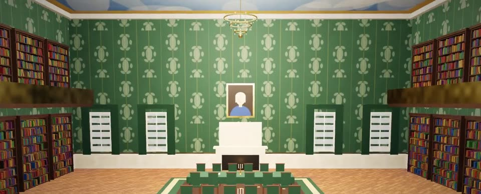<br/>**Lumière palace library** | 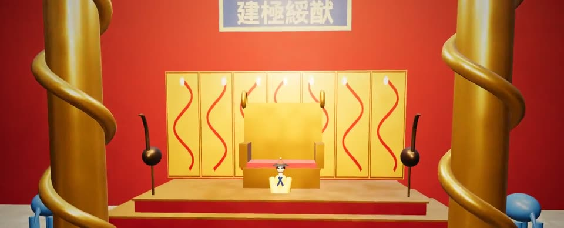<br/>**Dragon throne, Hall of Supreme Harmony** |

Press **E** in front of the door of any building that has one to go inside, and **E** at the door inside to come out. Rooms are built the first time you enter them.

- **Lumière:** the Palace Opera (stage, boxes, harpsichord), the Palace Library (two-storey shelves, gallery), the observatory's map room, the falconry mews, the marble bathhouse, the palace kitchen, the perfume laboratory, the silk workshop, the wine house and cellar, the clock tower's machine room, the hunting lodge, the jeweller's and tailor's workshop, the butler academy, the stud farm stable and the château stable.
- **Yùlóng Island:** the Hall of Supreme Harmony (dragon throne), the Hall of Tranquility (imperial library), the pagoda's Buddha hall, the porcelain, silk, carpet and jade workshops, the tea fermentation house and ten village houses.

## Yùlóng Island

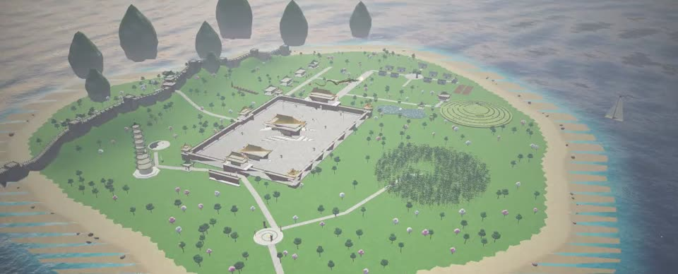

A Chinese imperial island southeast of Lumière, about 570 m off the south beach, visible on the horizon by its pagoda and karst towers. You get there by **flying with Pyra**: take off from the cage, fly southeast and land on the island (**E**). Pyra drops you off and flies back to her cage in Lumière; to go back, strike the gong on the **Dragon Terrace** in the northwest of the island.

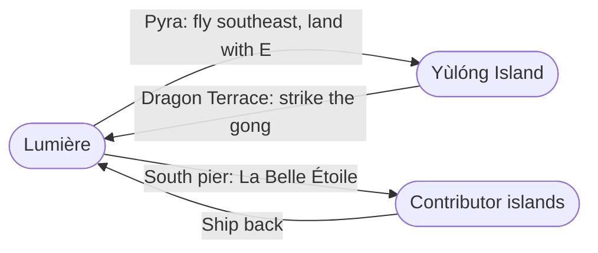

| | |
|:---:|:---:|
| 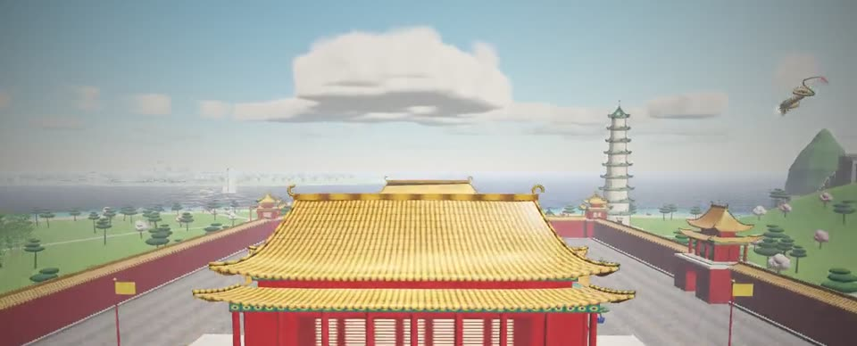<br/>**Forbidden City** | 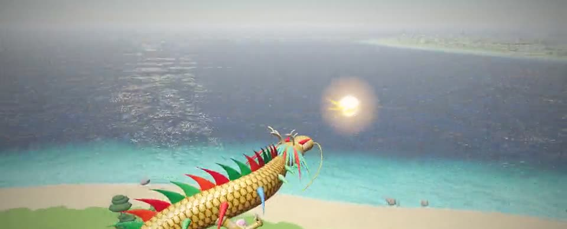<br/>**Yùlóng's dragon** |
| 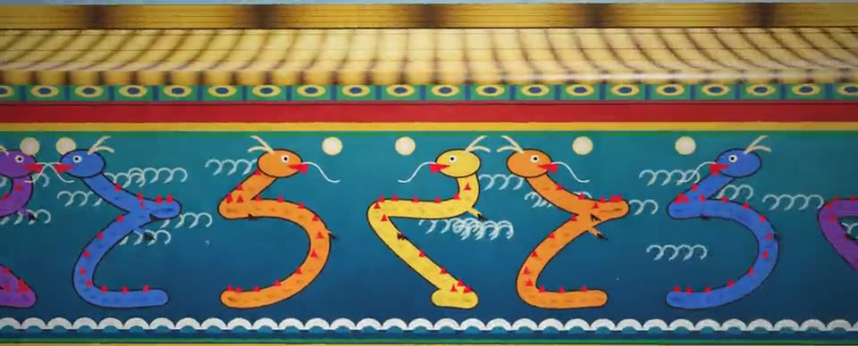<br/>**Nine-Dragon Wall** | 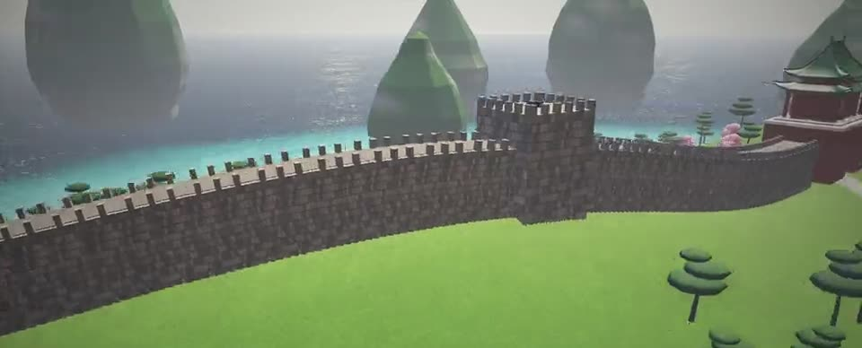<br/>**Great Wall** |
| 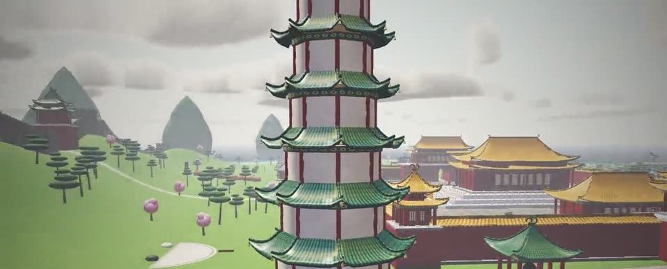<br/>**Cloud Bell Temple pagoda** | 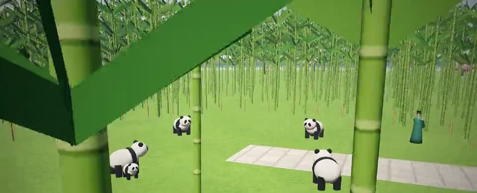<br/>**Bamboo forest and pandas** |
| 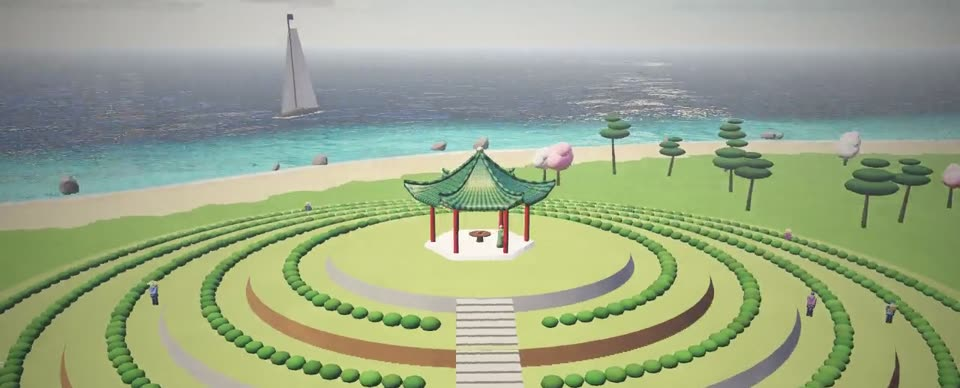<br/>**Terraced tea hill** | 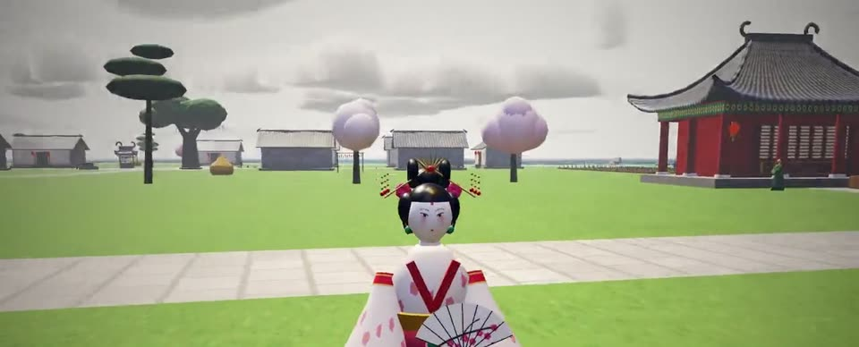<br/>**Princess Lìhuá** |

- **Forbidden City:** red walls and yellow glazed tiles, the Meridian Gate, corner towers, the Golden Water stream with five marble bridges, and the double-eaved Hall of Supreme Harmony on a three-tier marble terrace, with bronze cauldrons and lions. To the south, a paifang and an imperial way lined with stone guardians.
- **Great Wall:** winds along the eastern ridge, both ends plunging into the sea (the southern end is the Old Dragon's Head). Watchtowers and the "First Pass Under Heaven"; Commander Qī lights the beacon fires from tower to tower.
- **Cloud Bell Temple:** a nine-storey pagoda, a giant bronze bell, an incense burner and a yin-yang balance garden.
- **Nature:** a bamboo forest with pandas, a lotus and koi pond with a Moon Bridge and a water pavilion, a terraced tea hill with a tea pavilion on top, pines, plum blossoms and willows, and karst towers rising from the sea.
- **Crafts bazaar:** porcelain (dragon kiln), silk (mulberry garden), carpet and jade workshops, and the tea fermentation house.
- **Floating market and dragon boats:** race in the Dragon Boat Festival with Lóng Bō the boatman.
- **Yùlóng's dragon:** a wingless, gold-scaled Chinese dragon about 46 m long, with green and red manes, five-clawed feet and deer antlers, coiling over the island as it chases the flaming pearl.
- **Nine-Dragon Wall** and dragon-wrapped marble **huabiao** columns in front of the Meridian Gate; a paved palace courtyard, bonsai pots, a bronze crane and turtle, and banners.
- **Yùlóng Village:** ten grey-brick, tile-roofed peasant houses (red New Year couplets on the doors, "福", lanterns, drying corn and chillies), a well in the square, an old wishing tree hung with ribbons, a stone mill, chickens, vegetable fields and villagers.
- **Princess Lìhuá** by the lotus pond: white court make-up, hairpins and a fan; her fan dance earns culture points.
- **Interiors (enter with E at the door):** the dragon throne and the Emperor in the Hall of Supreme Harmony, the Buddha hall in the pagoda, the four craft workshops, the tea fermentation house and each of the ten village houses (a brick "kang" bed, a stove, an ancestral altar and the owner).

**Gameplay:** start production with the craftsmen. Choosing the right method at each stage decides the quality of the product (Common / Fine / Imperial). Every time she arrives from Lumière, Pyra brings Bordeaux wine and Grasse perfume in her saddlebags; trade them with Minister Wáng Ān for Chinese treasures. Trades earn **prestige**, and rituals (tea ceremony, bell, incense, meditation, koi, pandas, beacon fires, the festival) earn **culture points**; the more culture you have, the more valuable your trades become. Prestige unlocks titles:

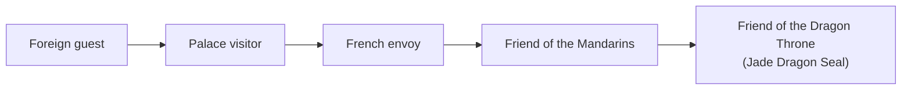

The island's music is pentatonic.

## Voyages between islands: contributor islands

Board the ship **La Belle Étoile** at the end of Lumière's south pier (or talk to Captain Jean-Baptiste) with **E** to sail to islands added by contributors. Each island is a single definition in `src/islands/<island>/island.js`. The game finds these files on its own, so there is no need to touch the main code. Islands are built on their first visit and only one is visible at a time. The shore, ocean, pier, exploration quest and saving all come from the system.

**Hútòng Island** (`src/islands/hutong/`) is the first contributor island: a Beijing hutong quarter whose streets and siheyuan courtyard houses are laid out by an algorithm (door numbers included), the Temple of Heaven, a Five Elements pagoda puzzle, a Hakka tulou, the Silk Road market behind moon gates, a Jiangnan canal village with moon bridges and wupeng boats, the Bamboo Mist Inn in a bamboo sea, the Lóngjǐ rice terraces and misty Zhangjiajie pillars with a Taoist temple, a spiral cliff stair and rope bridges. At night hundreds of red lanterns light the streets and lotus lanterns drift on the water.

To add your own island, see [CONTRIBUTING.md](CONTRIBUTING.md) (the step-by-step process) and [src/islands/ADA_TALIMATI.md](src/islands/ADA_TALIMATI.md) (rules and API). A working example: [src/islands/_sablon/island.js](src/islands/_sablon/island.js).

## Istanbul Bosphorus (anchored island)

Northwest of Lumière, at about the same distance as Yùlóng, lies the **Istanbul Bosphorus**: a hand-laid, scaled-down Istanbul. Beyoğlu in the north (Galata Tower, İstiklal Avenue and its tram, Taksim, Dolmabahçe), the Historic Peninsula in the southwest (Sultanahmet, Hagia Sophia, Topkapı, the Grand Bazaar, Süleymaniye, Eminönü), and the Asian side in the east (Üsküdar, Salacak, the Maiden's Tower, Haydarpaşa). The Bosphorus and the Golden Horn run between the shores; you can walk across the Galata and Bosphorus bridges. Bay-windowed houses, tulips, plane trees, ferries and gulls; a simit seller, fishermen, a tea man, a guide, a boatman, an ice-cream seller and the shopkeepers of the Grand Bazaar. A small quest: pet the city's 12 cats. Reach it by flying with Pyra or aboard La Belle Étoile; the horn at the landing field in Kadıköy calls Pyra to ride. **Anchored islands** like this one, which set `at`, are always visible and can be flown to (see [ADA_TALIMATI.md](src/islands/ADA_TALIMATI.md)).

## Atmosphere and lighting

- **Volumetric clouds:** the sky is drawn by ray marching through a cloud layer between 700 and 1650 m. Density is read from a tileable 3D Perlin-Worley texture and a 2D coverage texture, both generated at startup. Light is sampled towards the sun (Beer-Lambert, the "powder" effect, dual-lobe Henyey-Greenstein scattering): edges facing the sun shine silver and the bases darken. Clouds drift with the wind and their coverage follows the weather: scattered cumulus when sunny, broken overcast when cloudy, dark and thick in the rain, orange at sunset. They are rendered to a low-resolution target and composited by scene depth.
- **Cloud shadows:** the same coverage map is projected onto the ground along the sun direction, so cloud shadows slide across meadows and buildings.
- **Height fog:** aerial perspective that grows exponentially with distance and thins with altitude; looking towards the sun, the fog takes on the sun's colour.
- **Materials:** every surface gets world-space variation in colour and roughness (breaking up the flat "plastic" look). Walls near the ground and undersides receive less sky light (contact shadowing). Non-metallic surfaces reflect more of the HDRI ambient light.
- **Sky and sun:** in clear weather the sky is a more saturated blue with a deeper zenith. The sun comes from the south all day, so the château's front façade is lit.
- **Image:** HDR intermediate buffer, 4× MSAA anti-aliasing and cinematic colour grading (soft S-curve, warm highlights and cool shadows, vignette, fine film grain).
- **Quality setting:** High: half-resolution clouds, 48 steps, 4096 shadow map, 4× MSAA. Medium: fewer steps, 2× MSAA. Low: quarter resolution, no MSAA. Browsers without WebGL2 fall back to the old flat cloud layer.

## Project structure

```
index.html              UI skeleton (title screen, HUD, dialogue, menus)
src/main.js             game loop and state machine
src/world.js            château, garden, temple, guards, horses, weather, sword, wind shader
src/estate.js           stud farm, greenhouses, winter garden, meadows, flags, drifting petals
src/interior.js         inside the château: floors, stairs, rooms, furniture
src/sanctuary.js        dragon cage, Butterfly Valley, Vineyard of Eden, Princess Aurélie
src/dragonride.js       riding Pyra: flight physics, cameras, altitude readout, place titles, fire, landing
src/atmosphere.js       volumetric clouds, cloud shadows, fog, material patch, colour grading
src/royal.js            canal and gondolas, Avenue of Heroes, triumphal arch, night garden, clock tower, Hall of Mirrors, secret passages…
src/kit.js              shared building kit: buildings, columns, statues, figures, signs, merging
src/doors.js            detailed doors in three styles (palace, rustic, arched)
src/court.js            palace gardens: rose maze, swan pond, opera, ballroom, observatory, bathhouse, cellar…
src/china.js            Yùlóng Island: Forbidden City, Great Wall, pagoda, bamboo and pandas, tea hill, workshops, trade and prestige
src/coast.js            island shore, beach, ocean, pier (several islands in the same sea)
src/sea.js              Lumière's coast, pier, sailboats, gulls and the ship La Belle Étoile
src/longdragon.js       Yùlóng's long Chinese dragon (body re-laid every frame)
src/rooms.js            building interiors: entered through doors, built on first entry
src/rooms-lumiere.js    the interiors of Lumière's buildings
src/islands/index.js    archipelago: discovers and validates contributor islands, ship voyages, per-island collision and saves
src/islands/_sablon/    template for a new island (not loaded; copy it)
src/game/hero.js        player, rideable horse, third-person camera
src/game/content.js     characters, runes, medallions, tower, Moon Gate, sundial
src/game/archery.js     first-person archery: aiming, drawing, arrow ballistics
src/game/maze.js        seeded maze generation
src/game/collision.js   collision and ground height
src/game/audio.js       sound and music (Web Audio)
src/game/ui.js          HUD, compass, dialogue, quest journal
src/game/input.js       keyboard, mouse, touch
src/game/save.js        saving (browser local storage)
public/assets/          HDRIs, textures and models
docs/                   videos and README images
```

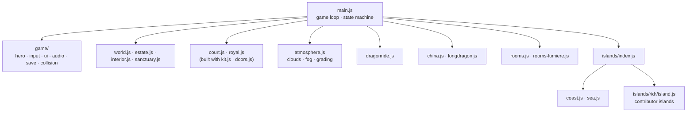

## Assets and licenses

All assets were downloaded from the `examples` folder of the three.js repository (r147).

| File | Source | License |
|---|---|---|
| `hdri/*.hdr` | Poly Haven (royal_esplanade, quarry_01, pedestrian_overpass, venice_sunset, moonless_golf) | CC0 |
| `textures/cim*.jpg` | OpenGameArt, "dark grass" | CC BY 3.0 (attribution required) |
| `textures/mermer_dama*.jpg`, `ahsap.jpg`, `su_normal.jpg` | three.js example textures | three.js repository |
| `textures/flare_hex.png` | hackcraft.de | CC0 |
| `textures/flare0.png`, `models/at.glb`, `flamingo.glb`, `papagan.glb`, `leylek.glb` | ROME "3 Dreams of Black" (ro.me) | CC BY-NC-SA 3.0 (non-commercial use) |
| `models/cicek.glb` | Kenney Nature Pack | CC0 |

If you want to use the project commercially, replace the horse and bird models and `flare0.png` with CC0 alternatives (for example from Poly Haven, Kenney or Quaternius).
